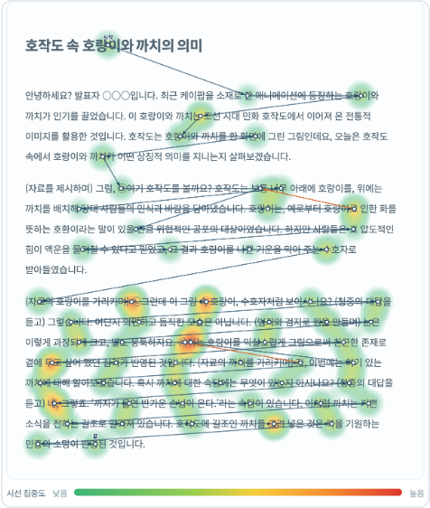

# LOOKteracy

<p>
  <a href="https://educollege.inha.ac.kr/bbs/edcollege/944/193812/artclView.do"></a>
  <a href="https://educollege.inha.ac.kr/bbs/edcollege/944/193812/artclView.do"></a>
</p>
<p>
  <a href="https://www.msit.go.kr"></a>
  <a href="https://www.iitp.kr"></a>
  <a href="https://toss.im"></a>
  
</p>
<p>
  <a href="https://www.inha.ac.kr"></a>
  <a href="https://educollege.inha.ac.kr"></a>
  <a href="https://swuniv.inha.ac.kr"></a>
</p>
<p>
  
  
  
  
  
  
  
  
</p>

웹캠으로 학생이 지문을 읽는 과정을 기록하고, 답안과 함께 분석해 개념 이해 상태를 진단하는 문해력 학습 서비스입니다. 이 폴더는 2026년 11월 14일 기준으로 지금까지 구현한 시스템 전체입니다.

<p align="center"></p>

## 1. 실행하기

**준비물**

- [Node.js](https://nodejs.org) 20.12 이상 (LTS 버전 권장)
- Chrome 또는 Edge 브라우저
- 웹캠이 있는 컴퓨터

별도 설치(`npm install`)는 필요 없습니다. Claude 채점을 쓸 때만 필요합니다(6장).

**Mac**

1. 압축을 풉니다.
2. `start-mac.command`를 더블클릭합니다. 서버 창이 열리고 잠시 뒤 브라우저가 **http://127.0.0.1:4186** 을 엽니다.
   - "확인되지 않은 개발자"나 "악성 코드가 없음을 확인할 수 없습니다" 경고가 뜨면, macOS 14 이하에서는 파일을 마우스 오른쪽 버튼으로 눌러 **열기**를 고릅니다. macOS 15 이상에서는 **시스템 설정 → 개인정보 보호 및 보안** 아래쪽의 **그래도 열기**를 누른 뒤 다시 실행합니다.
   - 그래도 열리지 않으면 터미널에서 직접 실행합니다. `cd ` 뒤에 압축을 푼 LOOKteracy 폴더를 터미널 창으로 끌어다 놓으면 경로가 들어갑니다.

     ```bash
     cd 압축을-푼-폴더/LOOKteracy
     node scripts/serve.mjs
     ```

3. 브라우저가 열리지 않으면 직접 **http://127.0.0.1:4186** 으로 들어갑니다.

**Windows**

1. 압축 파일을 마우스 오른쪽 버튼으로 눌러 **속성**을 열고, 아래쪽에 **차단 해제**가 있으면 체크한 뒤 확인을 누릅니다. 그다음 **압축 풀기**로 풉니다. 압축 파일 안에서 바로 실행하지 마세요.
2. `start-windows.bat`를 더블클릭합니다.
   - "Windows의 PC 보호" 창이 뜨면 **추가 정보 → 실행**을 누릅니다.
   - 직접 실행하려면 명령 프롬프트에서 폴더로 이동한 뒤 `node scripts\serve.mjs`를 입력합니다.
3. 브라우저가 열리지 않으면 직접 **http://127.0.0.1:4186** 으로 들어갑니다.

**끄기**: 서버 창을 닫거나 `Ctrl+C`를 누릅니다.

**다른 포트로 실행**: `node scripts/serve.mjs --port 4187` (또는 `npm run dev -- --port 4187`). 실행 파일을 쓸 때는 Mac은 `PORT=4187 ./start-mac.command`, Windows는 명령 프롬프트에서 `set PORT=4187` 다음에 `start-windows.bat`를 실행합니다. 포트를 바꾸면 브라우저 기록도 따로 저장됩니다(5장).

> 서버는 이 컴퓨터 안(`127.0.0.1`)에서만 열립니다. 다른 컴퓨터에서는 접속할 수 없습니다. 카메라도 `127.0.0.1`이나 `localhost` 주소에서만 켜지니, 서버를 켠 컴퓨터에서 바로 열어 주세요.

## 2. 처음 써 보기

### 가입과 로그인 (페이스패스)

1. 첫 화면에서 **시작하기**를 누르면 페이스패스 로그인 화면이 나옵니다.
2. 처음이라면 **학급 연결·페이스패스 등록**을 누릅니다.
3. 가입 유형(학생 또는 교사)을 고르고 **다음 단계**를 누릅니다. 이름(학생은 학급 연결 코드도)을 쓰고, 수집·보관 안내를 확인한 뒤 얼굴 등록으로 넘어갑니다.
4. **페이스패스 등록 시작**을 누르고 카메라를 허용합니다. 정면을 잠시 바라본 뒤 **눈을 한 번 깜빡이면** 등록됩니다. **등록 완료 · 로그인으로**를 누릅니다.
5. 로그인 화면에서 **얼굴 확인하기**를 누르고 정면을 본 뒤 눈을 한 번 깜빡이면 로그인됩니다.
   - 같은 얼굴로 학생과 교사를 모두 등록했다면 로그인할 때 어느 공간으로 갈지 고릅니다.

교사 화면만 빠르게 보려면 로그인 화면의 **학급 연결·페이스패스 등록** 오른쪽 작은 체크 아이콘을 누르세요. 얼굴 확인 없이 교사(김하늘 선생님) 공간으로 들어갑니다. 시연용 입구라 실제 사용 전에는 지워야 합니다(`docs/NOTES.md` 1장).

### 학생

1. 학생 홈에서 오늘의 지문(호작도 속 호랑이와 까치의 의미)을 시작합니다.
2. **학습 준비**: 카메라·환경을 점검한 뒤 시선을 보정합니다. 화면의 점 9개를 하나씩 바라보면서 각각 5번 누르고, 마지막에 3초 동안 가운데 점을 바라보면 보정 정확도가 나옵니다. 카메라를 쓸 수 없으면 점검 실패 안내에서 **카메라 없이 계속**을 눌러 시선 기록 없이 진행합니다.
3. **지문 읽기**: 읽는 동안 시선 좌표만 기록합니다(카메라 영상은 저장하지 않습니다). 다 읽으면 **읽기 완료 · 문항으로**를 누릅니다.
4. **문항 응답**: 선택형 1문항, 서술형 2문항입니다. 타이핑이나 필기로 답하고 **최종 제출**을 누릅니다.
5. 제출하면 **피드백·추천 학습**과 **나의 성장**에서 결과를 봅니다. 나의 성장에서 **다시 도전하기**를 누르면 회차별 변화율이 쌓입니다.

### 교사

1. 같은 브라우저에서 로그아웃한 뒤 교사로 로그인합니다.
2. **대시보드**: 개념 진단 분포, 변화율, 모둠 추천(멘토형·수준별)을 봅니다.
3. **진단·피드백**: 학생 목록 → 학생이 본 테스트 목록 → 리포트 순서로 들어갑니다.
   - 리포트 위쪽: 독해 속도·시선 고정 시간·시폭(평균 대비)과 오래 머문 단어, 되돌아 읽기, 주의 이탈, 건너뛴 단어
   - 탭: 히트맵, 시선 경로(경로 재생), 단어별 지표, 응답·루브릭
   - 오른쪽 열: 개념 진단과 레벨, 종합 결과(문해력 수준, 학년 상위 %), 학습 성장 추이, 5개 영역 점수(오각형 그래프)
4. 리포트의 **개인 피드백 편집**에서 피드백을 고쳐 **검토 완료 · 게시**를 누르면 학생 화면에 반영됩니다.
5. **그룹 관리**: 테스트별로 학생 분류를 보고 최종 그룹을 편성해 **최종 그룹 저장**을 누릅니다.

학생이 응시한 기록을 교사 리포트에서 보려면 **같은 컴퓨터, 같은 브라우저, 같은 주소**에서 학생으로 응시한 뒤 교사로 로그인해야 합니다(5장).

## 3. 구현된 기능

| 기능 | 내용 |
|---|---|
| 페이스패스 | face-api.js로 얼굴 특징값 128개를 만들어 비교(차이 0.5 이하이면 같은 사람). MediaPipe 눈 깜빡임 점수로 사진 로그인을 막음. 학생·교사 가입 구분, 같은 얼굴로 역할별 등록 |
| 시선 추적 | WebGazer 기반. 9점 보정(점마다 5번) + 3초 정확도 검증. 본문이 스크롤돼도 글자 기준 좌표로 기록. 흔들림을 줄인 뒤 고정점 계산(200ms 이상, 110px 범위). 보정 오차로 시선이 한쪽으로 밀리면 글자 영역에 맞춰 정렬 |
| 교사 리포트 시각화 | 히트맵, 번호·화살표가 있는 시선 경로와 경로 재생, 단어별 지표(머문 시간, 되돌아 읽기 등). 독해 속도·시선 고정 시간·시폭과 평균 대비 비교 |
| 채점 | 선택형은 정답 비교. 서술형은 근거 낱말과 연결 표현으로 0~3점. 빈 답, 자모·영문 나열, 지문 베끼기는 따로 표시. 선택: Claude 재채점 |
| 5개 영역 점수 | 읽기 유창성, 핵심 내용 파악, 맥락 파악, 추론 능력, 비판적 읽기를 100점 기준 오각형 그래프로 표시. 답안 채점과 시선 기록으로 계산(식은 `docs/NOTES.md` 2장) |
| 종합 결과 | 이해 점수로 문해력 수준(매우잘함·잘함·보통·노력요함)과 학년 상위 %를 표시 |
| 피드백 | 나의 강점, 보완할 점, 다음 읽기 전략, 문항별 확인. 교사가 편집·게시하면 학생 화면에 반영 |
| 성장·진단 | 개념 3분류(기존 지식·난개념·오개념)로 5개 개념(핵심 주장, 핵심 개념, 개념 간의 관계, 근거와 사례, 적용 및 확장) 진단. 레벨 1~4, 목표 세우기, 다시 도전, 변화율, 칭찬 보내기 |
| 교사 대시보드 | 개념 진단 분포(오개념 25% 이상이면 수업 설명 점검, 난개념 35% 이상이면 다시 다루기), 변화율, 모둠 추천(멘토형·수준별) |
| 그룹 관리 | 테스트별 4가지 수준 분류, 교사 최종 그룹 편성·저장 |

## 4. 시연용으로 정해 둔 부분

실제 분석이 아니라 화면을 보여 주기 위해 값이 정해져 있는 부분입니다. 자세한 내용은 `docs/NOTES.md` 1장에 있습니다.

- 학급의 다른 학생 10명(김서윤, 이지우 등)은 교사 화면을 채우는 샘플 데이터입니다. 샘플 학생의 이번 회차 리포트는 시선 지표, 히트맵, 답안, 종합 결과가 모두 같은 고정 화면입니다. 실제로 응시한 사람은 목록 위쪽에 실제 기록으로 나옵니다.
- 지난 1·2회차 테스트와 그 결과 리포트는 샘플입니다.
- 학습 성장 추이 그래프(8~12월)는 정해 둔 예시 값입니다. 실제 회차별 점수는 학생의 **나의 성장** 화면에 있습니다.
- 그룹 관리의 4가지 수준 분류는 정해 둔 예시 명단입니다.
- 필기 모드의 **OCR로 변환**은 필기를 읽지 않고 문항마다 정해진 문장을 넣습니다.
- 리포트 PNG 출력은 학생 이름만 바뀌고 내용은 고정입니다.
- 테스트 구성·배정과 자료실에 더한 자료는 새로고침하면 사라집니다.
- 추천 지문 카드의 출처 표기는 예시입니다.
- 가입할 때 학급 연결 코드와 수집·보관 안내 체크는 확인하지 않습니다.
- 로그인 화면의 교사 바로가기 아이콘과 `#login-teacher`의 로그인 폼은 확인 없이 교사로 들어가는 시연용 입구입니다.

## 5. 기록과 초기화

- 모든 기록(페이스패스 등록 정보, 시선 기록, 답안, 성장 기록, 그룹 편성)은 **이 브라우저의 localStorage**에만 저장됩니다. 서버나 다른 컴퓨터와 공유되지 않습니다.
- 브라우저는 주소마다 기록을 따로 둡니다. `http://127.0.0.1:4186`과 `http://localhost:4186`, 포트가 다른 주소는 서로 다른 기록을 씁니다.
- 처음 상태로 돌리려면 **http://127.0.0.1:4186/#reset** 을 엽니다(이 주소의 LOOKteracy 기록이 모두 지워집니다). 로그인 화면의 **로그인 도움 → 모든 기록 초기화**도 같습니다.
- 얼굴 사진과 카메라 영상은 저장하지 않습니다. 페이스패스는 얼굴 특징값(숫자 128개)만 저장합니다.

## 6. Claude 채점 (선택)

API 키가 없어도 루브릭 채점으로 모두 동작합니다. 서술형을 Claude로 다시 채점하려면:

1. 폴더에서 `npm install`을 실행합니다.
2. `.env.example`을 복사해 `.env`를 만듭니다. Mac은 `cp .env.example .env`, Windows는 `copy .env.example .env`입니다. `.env`를 열어 `ANTHROPIC_API_KEY=` 뒤에 키를 넣습니다.
3. 서버를 다시 켭니다. **http://127.0.0.1:4186/api/grader** 에서 `"configured":true`가 보이면 준비된 것입니다.
4. 제출할 때마다 서술형을 다시 채점하고, 교사 리포트의 **Claude로 다시 채점**으로도 실행할 수 있습니다.

- 모델은 기본 `claude-opus-5-5`이고, `.env`의 `LOOKTERACY_GRADER_MODEL`로 바꿀 수 있습니다.
- 키는 로컬 서버에만 있고 브라우저로 보내지 않습니다. 채점할 때 지문, 문항, 루브릭, 답안, 시선 요약, 응답 시간이 Anthropic API로 전송됩니다. 학생 이름은 보내지 않습니다.
- `.env` 파일은 다른 사람에게 공유하지 마세요.

## 7. 인터넷 연결

얼굴 인식, 눈 깜빡임, 시선 추적 모델 파일은 모두 `dist/vendor/`에 들어 있어 따로 내려받지 않습니다. 인터넷으로 나갈 수 있는 요청은 다음과 같습니다.

- `styles.css`가 Google Fonts(`fonts.googleapis.com`, `fonts.gstatic.com`)에서 Noto Sans KR 글꼴을 불러옵니다. 인터넷이 없으면 시스템 글꼴로 보입니다.
- MediaPipe 라이브러리가 사용 기록을 Google 서버(`odml.pa.googleapis.com`)로 보냅니다. 페이스패스에서 눈 깜빡임 모델을 쓰면, 인터넷에 연결되어 있을 때 이 요청이 나갑니다.
- Claude 채점을 켠 경우에만 Anthropic API로 요청을 보냅니다(6장).

## 8. 문제 해결

| 증상 | 확인할 것 |
|---|---|
| 브라우저가 열리지 않음 | 서버 창이 켜져 있는지 보고, 주소창에 http://127.0.0.1:4186 을 직접 넣습니다 |
| "포트를 이미 다른 프로그램이 쓰고 있습니다" | 이미 열린 LOOKteracy 서버 창을 닫거나 다른 포트로 실행합니다(1장) |
| 카메라가 켜지지 않음 | 주소창 왼쪽 아이콘에서 카메라를 허용합니다. 화상 회의 앱처럼 카메라를 쓰는 다른 프로그램을 끕니다. Mac은 **시스템 설정 → 개인정보 보호 및 보안 → 카메라**에서 브라우저를 켭니다 |
| 얼굴 로그인이 되지 않음 | 밝은 곳에서 정면을 보고 다시 확인합니다. 계속 안 되면 **로그인 도움**에서 등록 정보를 지우고 다시 등록합니다 |
| 교사 화면에 학생 기록이 없음 | 학생으로 응시한 브라우저와 주소(포트 포함)가 같은지 확인합니다 |
| 시선 정확도가 낮음 | 밝은 곳에서 화면 정면에 앉고, 보정 뒤에는 머리를 크게 움직이지 않습니다. 글자 크기나 창 크기를 바꾸면 다시 보정합니다 |
| Claude 채점이 되지 않음 | `/api/grader`가 `"configured":false`이면 `.env`의 키를 확인하고 서버를 다시 켭니다. `unavailable`이면 `npm install`을 실행합니다 |

- 처음 카메라를 켤 때 얼굴·시선 모델을 불러오느라 몇 초 걸릴 수 있습니다.
- Safari는 권장하지 않습니다. Chrome이나 Edge를 쓰세요.

## 9. 폴더 구조

```text
LOOKteracy/
├─ start-mac.command      Mac 실행 파일
├─ start-windows.bat      Windows 실행 파일
├─ README.md
├─ package.json           실행·검사 명령 (npm run dev / check / test)
├─ package-lock.json
├─ .env.example           Claude 채점용 키 자리
├─ dist/                  화면 전체 (index.html, 화면 스크립트, 스타일)
│  └─ vendor/             얼굴 인식·눈 깜빡임·시선 추적 모델 (face-api.js, MediaPipe, WebGazer)
├─ scripts/
│  ├─ serve.mjs           로컬 서버 (기본 포트 4186)
│  ├─ grade.mjs           Claude 채점 (/api/grade, /api/grader)
│  ├─ check.mjs           스크립트 문법·연결 파일 검사
│  └─ test.mjs            테스트 실행
├─ tests/                 시선 보정 애니메이션, 그룹 편성 테스트
└─ docs/
   ├─ ARCHITECTURE.md     코드 구조, 화면 목록, 저장 데이터, 서버 API
   └─ NOTES.md            현재 한계, 기준값과 바꾸는 곳, 지문 출처, 변경 내역
```

검사: `npm run check`, `npm test` (둘 다 `npm install` 없이 돌아갑니다)

## 10. 사용한 오픈소스

| 이름 | 쓰는 곳 | 라이선스 | 라이선스 파일 |
|---|---|---|---|
| face-api.js (@vladmandic/face-api 1.7.15) | 얼굴 인식 | MIT | `dist/vendor/face-api/LICENSE` |
| MediaPipe Tasks Vision | 눈 깜빡임 확인 | Apache-2.0 | `dist/vendor/mediapipe-tasks/LICENSE` |
| WebGazer.js 3.5.3 | 시선 추적 | GPL-3.0-or-later | `dist/vendor/webgazer/LICENSE.md`, `dist/vendor/webgazer/GPL-3.0.txt`(전문) |
| MediaPipe Face Mesh (WebGazer와 함께 씀) | 시선 추적용 얼굴 특징점 | Apache-2.0 | `dist/vendor/webgazer/mediapipe/face_mesh/LICENSE` |
| TensorFlow.js (webgazer.js 안에 포함) | 시선 추적 계산 | Apache-2.0 | 없음 |
| Anthropic TypeScript SDK 1.8.0 (선택) | Claude 채점 | Apache-2.0 | `npm install` 뒤 `node_modules/@anthropic-ai/sdk` |
| Noto Sans KR (Google Fonts) | 글꼴 | OFL-1.1 | 인터넷에서 불러옴 |

WebGazer.js는 GPL-3.0-or-later입니다(webgazer.js 머리말에는 기업 가치 100만 달러 미만 조직은 LGPLv3로 쓸 수 있다고 적혀 있습니다). 이 시스템을 외부에 배포할 때는 라이선스 조건을 확인해야 합니다. WebGazer의 `LICENSE.md`는 안내문이라, GPL-3.0 전문(https://www.gnu.org/licenses/gpl-3.0.txt)을 같은 폴더에 `GPL-3.0.txt`로 함께 넣어 두었습니다.
